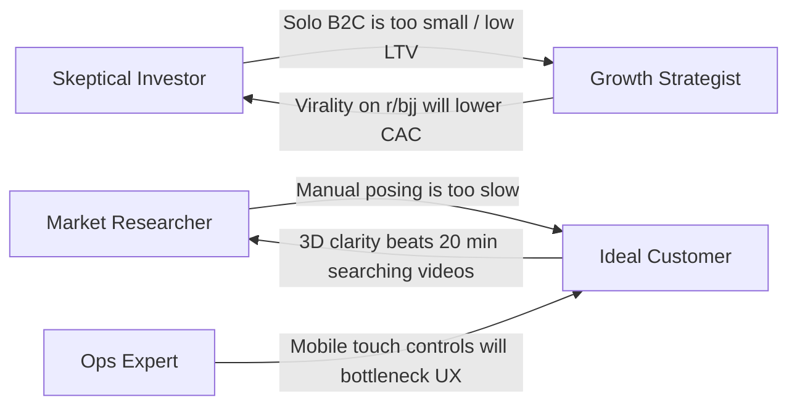

# Business Idea Validation: Arsenal (BJJ & Grappling Technique Intelligence)

---

### **System & Product Profile**
* **Business Idea:** **Arsenal** — A specialized 3D technique intelligence and game-mapping platform. It combines a dual-mannequin 3D inverse kinematics (IK) posing engine, structured technique notes with embedded 3D scene states, and an interactive node-graph system canvas to visualize martial arts positions, transitions, counters, and decision trees.
* **Target Customer:** Brazilian Jiu-Jitsu (BJJ), Submission Grappling, and MMA practitioners (from committed hobbyists to competitive athletes and coaches/gym owners) who struggle to retain, organize, and systematize complex movement sequences using standard text notes or scattered video clips.

---

## 1. Council of Five Advisors

```
                              ┌──────────────────────────┐
                              │     COUNCIL OF FIVE      │
                              └────────────┬─────────────┘
          ┌─────────────────┬──────────────┼──────────────┬─────────────────┐
          ▼                 ▼              ▼              ▼                 ▼
   Market Researcher   Skeptical VC   Ideal Customer  Growth Strategist   Ops Expert
```

---

### Advisor 1: The Market Researcher
* **Focus:** Total Addressable Market (TAM), competitive landscape, and user behavior trends.

* **Biggest Opportunity:** 
  > The combat sports instructional market is experiencing peak monetization (BJJ Fanatics, Submeta, FloGrappling, GrappleArts), yet **post-instructional synthesis** is entirely unsolved. Grapplers spend hundreds of dollars on video instructionals but retain less than 10%. Positioning Arsenal not as a generic notes app, but as the *interactive companion operating system for combat sports study*, taps directly into high-intent, high-discretionary-spending practitioners.
* **Weakest Assumption:** 
  > *That martial artists want to build 3D models from scratch after getting home exhausted from open mat.* The cognitive load of 3D joint manipulation is orders of magnitude higher than bookmarking an Instagram reel or scribbling a two-line note in Apple Notes.
* **Likely Obstacle:** 
  > Extreme market fragmentation and habit entrenchment. Users default to the path of least resistance: saving timestamped video links, YouTube playlists, or raw smartphone camera rolls.
* **One Improvement:** 
  > **Pre-populated "Canon" Library:** Provide 100+ fully-built verified system graphs and position templates (e.g., standard Danaher/Gordan Ryan front headlock systems, Marcelo Garcia butterfly guard, Mikey Musumeci leglock matrix) so users start by *forking and customizing* rather than posing mannequins from a blank canvas.

---

### Advisor 2: The Skeptical Investor
* **Focus:** Unit economics, defensibility, willingness to pay, and venture scale.

* **Biggest Opportunity:** 
  > **B2B Academy & Curriculum Licensing:** Transitioning from single-user B2C hobbyists to B2B SaaS for gym owners and affiliation networks (e.g., Gracie Barra, Alliance, 10th Planet) who need standardized, interactive white-belt-to-black-belt curriculum software to reduce student churn.
* **Weakest Assumption:** 
  > *That single-user B2C subscription revenue will offset customer acquisition costs (CAC).* BJJ is a passionate but niche market. A $7–$12/month consumer app targeting solo hobbyists risks a high churn cliff once the novelty of 3D posing wears off.
* **Likely Obstacle:** 
  > **High Time-to-Value (TTV) Churn:** If a user cannot build a clean, accurate representation of a complex Dela Riva sweep within 90 seconds, they will bounce immediately and never return.
* **One Improvement:** 
  > Introduce a **Community Marketplace & Creator Monetization Tier**: Allow elite black belts and content creators to publish and sell proprietary system trees and 3D breakdowns directly on Arsenal, with Arsenal taking a 15–20% marketplace cut.

---

### Advisor 3: The Ideal Customer (BJJ Purple Belt / Assistant Coach)
* **Focus:** Practical utility, mat-side reality, and personal pain points.

* **Biggest Opportunity:** 
  > **Visualizing Micro-Grips and Levers:** Text notes cannot explain *which hip is angled, whether the toes are active or flat, or where the underhook pressure drives*. The 3D dual-mannequin viewer and node graph solve the exact "mental fog" grapplers face when mapping out dilemma branches (e.g., *"If they underhook, go to kimura; if they flatten out, take the back"*).
* **Weakest Assumption:** 
  > *That posing 3D joints on mobile/touch screens is smooth.* After 90 minutes of hard sparring, fingers are swollen and tired; if the 3D IK handles are clunky or hard to drag on a phone or tablet, I will close the app and take a screenshot of a video instead.
* **Likely Obstacle:** 
  > **Nuance Blind Spots:** Grappling is defined by friction, fabric grips (in the Gi), weight distribution, and subtle tension—elements that simplified 3D mannequins cannot inherently convey unless notes and visual cues (pressure arrows, grip indicators) compensate for them.
* **One Improvement:** 
  > Add **Grip & Vector Overlays**: Allow users to click contact points to toggle Gi/No-Gi grips (collar-and-elbow, pistol grip, seatbelt, 2-on-1) and place directional force/pressure arrows directly in the 3D viewport.

---

### Advisor 4: The Growth Strategist
* **Focus:** Virality, distribution loops, activation funnels, and retention.

* **Biggest Opportunity:** 
  > **Built-in Product Virality via Graph & Frame Sharing:** Grapplers love arguing about technique theory on Reddit (`r/bjj`), Discord, and Instagram. A single-click *"Export interactive system link / embeddable animated GIF"* turns every user into a brand ambassador whenever they share a technique sequence or counter-strategy online.
* **Weakest Assumption:** 
  > *Organic word-of-mouth will drive steady top-of-funnel without embedded social mechanics.* Without public interactive embeds and social discovery feeds, Arsenal remains a siloed personal notebook.
* **Likely Obstacle:** 
  > **The "Empty Canvas" Activation Valley:** Over 80% of signups will drop off if they land on an empty dashboard with no immediate visual payoff or interactive tutorial.
* **One Improvement:** 
  > **"One-Click System Sharing & Social Cards":** Automatically generate high-res, branded flow-chart cards with QR codes and interactive WebGL preview links optimized for Instagram Carousels, Reddit threads, and YouTube video descriptions.

---

### Advisor 5: The Operations & Engineering Expert
* **Focus:** Technical feasibility, performance, scalability, and UX friction.

* **Biggest Opportunity:** 
  > **Lightweight Declarative Architecture:** Because Arsenal stores poses as compact JSON (`SceneJSON`) and graph coordinates rather than heavy 3D asset files or video blobs, the backend bandwidth and MongoDB storage overhead are near-zero. This allows a generous free tier with virtually zero marginal server cost per user.
* **Weakest Assumption:** 
  > *Browser-based WebGL and Three.js IK will perform smoothly across low-end mobile devices without rendering lag or touch gesture conflicts.*
* **Likely Obstacle:** 
  > **Input Ergonomics:** 3D manipulation requires translating 2D screen touches (X/Y) into 3D rotational coordinates (X/Y/Z). Joint limits, collision detection, and bone hierarchy can produce unnatural "folding" or limb inversion, frustrating non-technical users.
* **One Improvement:** 
  > **Hybrid Pose Snapping & AI / Video Pose Extraction Roadmap:** Provide snap-to-target presets (e.g., "snap right hand to opponent's left ankle") and build a roadmap feature allowing users to upload a 3-second video clip to auto-estimate the mannequin starting pose.

---

## 2. Cross-Council Debate & Challenge Round



* **The Skeptical Investor challenges the Growth Strategist:**
  > *"You talk about viral graph sharing, but who pays recurring subscriptions? Grapplers will share free images on Reddit and never buy the software. If we don't pivot to B2B curriculum software for gyms, we're building a vanity toy with high churn."*
* **The Growth Strategist counters the Skeptical Investor:**
  > *"Every dominant creator-led B2B software began as a beloved single-player tool (Figma, Notion, Obsidian). If we force enterprise gym management upfront, we kill grassroots community love. The single-player experience creates the demand that coaches bring into their gyms."*
* **The Market Researcher challenges the Ideal Customer:**
  > *"You say you want this, but in practice, do you actually spend 10 minutes after training to pose a mannequin, or do you just watch Lachlan Giles on your phone in bed? The friction of manual creation will kill daily active usage."*
* **The Ideal Customer fires back at the Market Researcher:**
  > *"I spend 30 minutes rewinding a video 15 times trying to see where a leg was placed. If Arsenal gives me a starter template of the position that I can just tweak in 30 seconds and connect to my sweep tree, it saves me hours of frustration. The key is that I shouldn't have to build it from zero."*
* **The Operations Expert challenges the Ideal Customer & Strategist:**
  > *"Building precision 3D poses on a mobile device is notoriously difficult. If users get limb distortion on touch screens, they'll abandon the app. We must lock down preset-based snapping before pushing broad viral marketing."*

---

## 3. Chairman's Verdict

```
┌──────────────────────────────────────────────────────────┐
│                   CHAIRMAN'S VERDICT                     │
│                                                          │
│                      SCORE: 7.8 / 10                     │
│                                                          │
│  "A high-utility, technically elegant concept that hits  │
│   a real cognitive bottleneck in combat sports. Its      │
│   fate hinges on eliminating user creation friction."    │
└──────────────────────────────────────────────────────────┘
```

### 1. Final Score
**7.8 / 10**
> *Arsenal solves a genuine, painful problem (technique retention and tactical systemization) with a differentiated 3D + Node Graph approach. Its score is tempered only by the behavioral friction of manual 3D modeling and the niche nature of solo B2C subscription pricing.*

---

### 2. Strongest Reason to Pursue It
> **Unmatched Visual Superiority over Text & Static Notes:** Grappling is a 3-dimensional geometric puzzle of angles, levers, frames, and branching logic. Text notes fail completely at capturing positional geometry, and video is linear, unsearchable, and non-interactive. Arsenal owns the exact sweet spot between a dynamic 3D sandbox and a tactical mind map.

---

### 3. Biggest Reason It Could Fail
> **The Creation Friction Trap:** If building a technique node feels like doing CAD work instead of jotting down a quick training thought, users will admire the product on launch day and never open it again. *Consumption and modification must be effortless; creation cannot be a chore.*

---

### 4. Three Assumptions You MUST Test

| # | Critical Assumption | How to Test | Success Metric |
|---|---------------------|-------------|----------------|
| **1** | **Workflow Speed:** Users are willing to spend 1–2 minutes after training to record techniques if templates are available. | Track time-to-save for first-time users using pre-built templates vs. blank canvas. | $\ge 60\%$ complete their first system node within 90 seconds. |
| **2** | **Organic Distribution:** Interactive system shares generate high-intent inbound signups from combat sports communities. | Post 3 interactive system breakdowns (e.g. "K-Guard to Matrix Breakdown") to `r/bjj` and Grappling Discords with public share links. | $\ge 15\%$ click-to-signup conversion from public shared links. |
| **3** | **Willingness to Pay:** Dedicated practitioners or coaches find enough recurring value to pay \$8–\$15/mo (or gyms \$49+/mo). | Offer a lightweight "Arsenal Pro" early-bird pre-order or waitlist with gated features (unlimited systems, custom branding, PDF/PNG export pack). | $\ge 5\%$ of active beta users commit or join the paid tier waitlist. |

---

### 5. Low-Cost 7-Day Validation Plan

```mermaid
gantt
    title 7-Day Low-Cost Validation Sprint
    dateFormat  D
    axisFormat Day %d
    section Research & Asset Prep
    Day 1 - Pre-populate 5 Canon Systems       :active, d1, 1, 1d
    Day 2 - Record 60s Demo & Interactive Links :d2, after d1, 1d
    section Community Seeding
    Day 3 - Seed on Reddit & Discords           :d3, after d2, 1d
    Day 4 - Direct Coach / Purple Belt Outreach :d4, after d3, 1d
    section Data & Synthesis
    Day 5 - Analyze Funnel & Heatmaps           :d5, after d4, 1d
    Day 6 - Test Commercial Intent (Paywall)    :d6, after d5, 1d
    Day 7 - Council Post-Mortem & Pivot Decision:d7, after d6, 1d
```



* **Day 1: Pre-Populate 5 "Signature Systems"**
  * Build 5 high-demand, universally recognized technique trees in Arsenal (e.g., *Straight Ankle Lock System*, *Body Lock Pass Matrix*, *Closed Guard Triangle/Armbar/Omoplata Dilemma*).
  * Ensure every frame has clear notes and camera angles.
* **Day 2: Create a 60-Second "Show, Don't Tell" Screen Capture**
  * Record a smooth, high-energy clip: moving from a 3D pose $\rightarrow$ capturing a frame $\rightarrow$ wiring the node into an interactive tree $\rightarrow$ rotating the 3D model.
* **Day 3: Seed in Core Grappling Hubs**
  * Post the video and interactive `/share/` links on `r/bjj`, grappling subreddits, and prominent BJJ Discord channels with the hook: *"I got tired of losing techniques in my Apple Notes, so I built a 3D interactive system mapper."*
* **Day 4: Direct Coach & High-Belt Outreach**
  * DM 20 local gym coaches and active competition purple/brown/black belts on Instagram. Offer them instant access to map their academy's syllabus or competition game plan.
* **Day 5: Measure Friction & Session Recordings**
  * Review web analytics (e.g., PostHog / Microsoft Clarity). Identify where drop-offs happen: Do users interact with the 3D mannequin, or do they drop out on bone rotation?
* **Day 6: Test Economic Intent (The "Early Supporter" Pass)**
  * Display a simple modal for power features (e.g. *Unlimited Private Systems*, *High-Res Video/PNG Export*, *Curriculum Folder Sharing*): *"Join the Founder's Club for \$39/year."*
* **Day 7: Synthesize Data & Decide**
  * If users love *viewing/sharing* systems but struggle to *create* them $\rightarrow$ **Pivot priority immediately to a pre-built template library and community fork model.**
  * If gyms express interest in standardizing student curriculum $\rightarrow$ **Introduce B2B Academy Team workspaces.**
